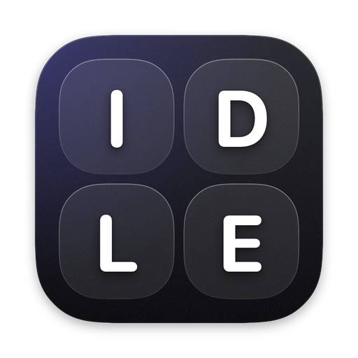
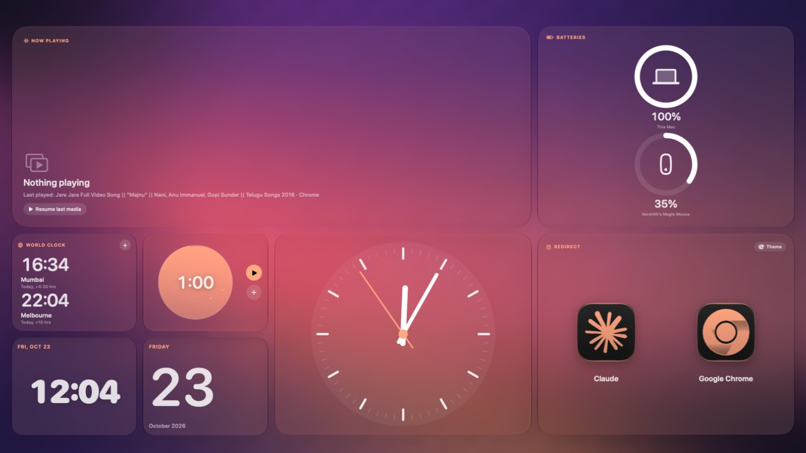
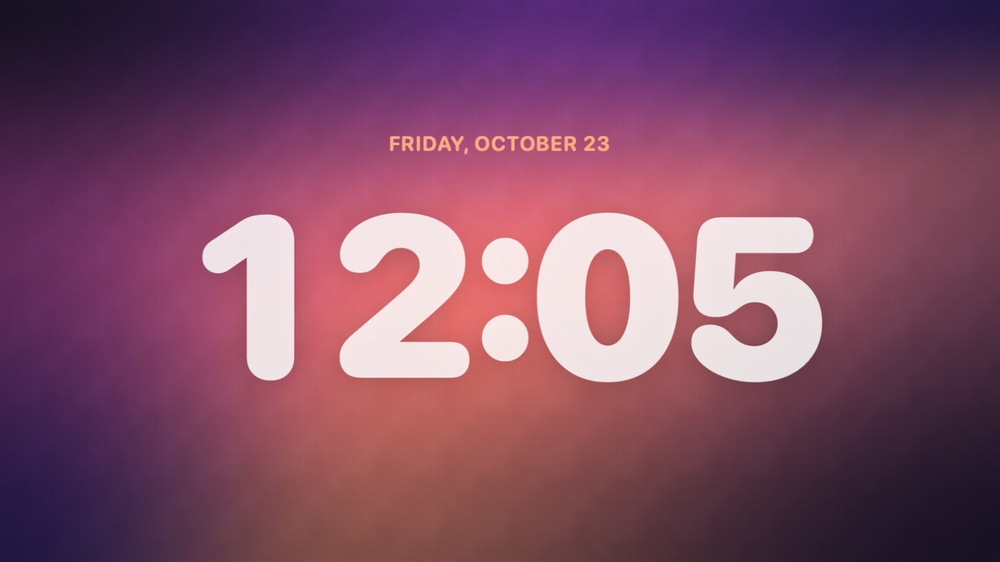
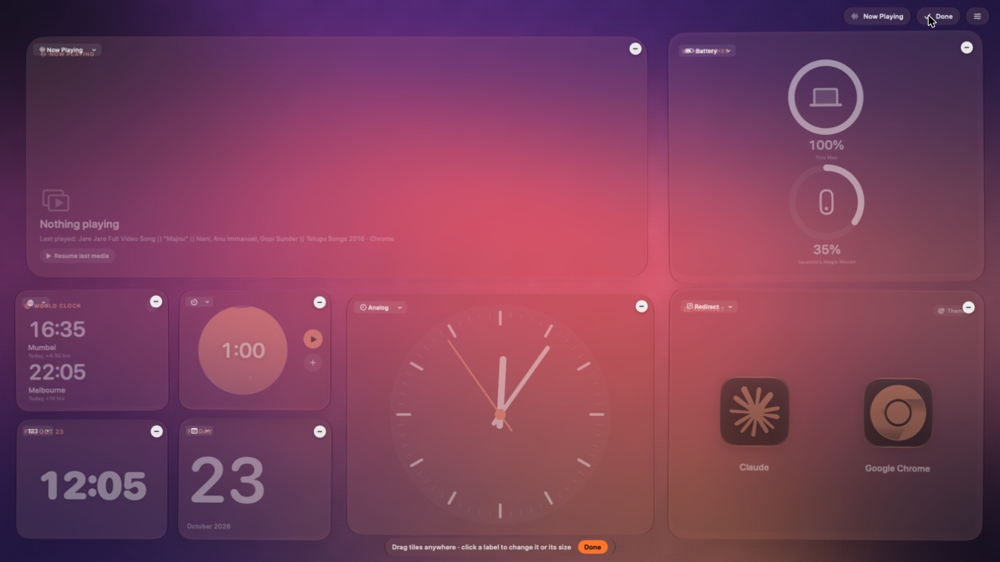
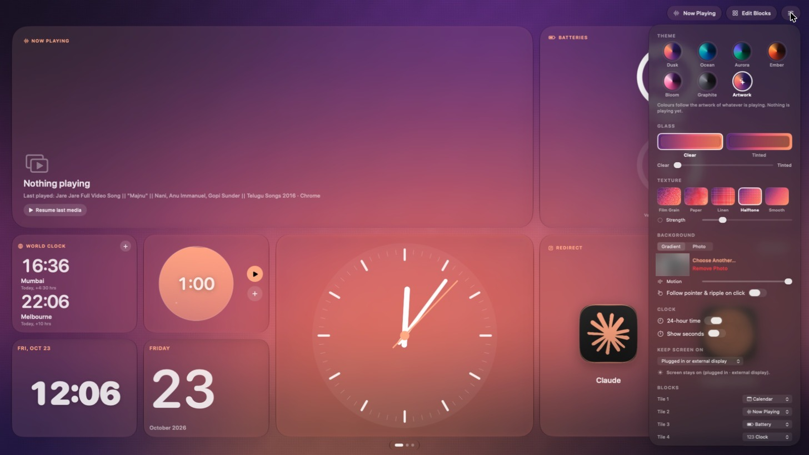

<p align="center">
  
</p>

<h1 align="center">Idle Mode</h1>

<p align="center">
  A calm, glanceable screen for your Mac when you step away.<br>
  Time, music, calendar, timers and more, readable from across the room.
</p>

<p align="center">
  
  
  
  
</p>



## Why

Your MacBook is plugged into a big display, and for much of the day you aren't actually using it: you're making coffee, on a call, or reading. The screen sits there dark or full of half-finished windows.

Idle Mode turns those moments into something worth glancing at, a little like StandBy on iPhone. It shows a full-screen panel of tiles you arrange yourself, on a softly moving background that takes its colours from whatever is playing.

## Features

**Dashboard.** Arrange tiles on a 6 × 4 grid. Drag them, resize them (Mini, Small, Wide, Tall, Large), add more while there's room, and remove the ones you don't need.

| Tile | What it shows |
|---|---|
| Clock | Large digital time, in 11 typefaces |
| Analog | A smooth analog clock |
| Calendar | The month, or today's date on a Mini tile |
| Now Playing | Artwork, title, progress, playback, shuffle, repeat, volume and sound output |
| Batteries | This Mac plus connected AirPods, Beats, and Magic Keyboard, Mouse and Trackpad |
| Timer | A live timer with three faces, a draggable dial and a full-screen alarm |
| World Clock | Up to ten cities; the layout adapts to fit |
| Redirect | One to four shortcuts to your favourite apps |
| System | CPU and memory |
| Note | A short note to yourself |

**Now Playing** works with Apple Music, Spotify, and media playing in Chrome, Arc, Brave, Edge, Vivaldi and Safari (YouTube, YouTube Music, Spotify Web, SoundCloud and others). When nothing is playing, *Resume last media* starts whatever played last. The speaker button switches sound between your Mac, AirPods, displays and AirPlay speakers, and connects paired headphones.

**Timer.** Choose from three faces: *Pulse*, *Tide* and *Halo*. Each beats in time with the countdown, breathes while paused, and leans toward the pointer. Five options set the face, colour, rhythm (heartbeat, breathe or still), sound (alarm, chime or silent) and an automatic focus-and-break cycle. When time is up, the alarm fills every display, above any app.

**Redirect.** Pick up to four apps and open any of them with one click. Icons can match your theme or show as Dark, Clear or Original.

**Three pages.** Use the Dashboard, a full-screen Clock, or a large Now Playing view. Swipe with two fingers or use the arrow keys.

**Make it yours.** Choose a theme, or *Artwork*, which follows the album art. You can also pick clear or tinted glass, a film-grain, paper, linen or halftone texture, a gradient or your own photo as the background, and motion that follows the pointer.

**Stays on when it should.** The screen stays awake while your Mac is plugged in or connected to an external display. Otherwise your normal display-sleep setting applies. You can change this under *Customise › Keep Screen On*.

<table>
  <tr>
    <td width="50%"></td>
    <td width="50%"></td>
  </tr>
  <tr>
    <td align="center">Clock</td>
    <td align="center">Edit tiles</td>
  </tr>
</table>



## Install

1. Download the **.dmg** from the [latest release](../../releases/latest).
2. Open it and drag **Idle Mode** into **Applications**.
3. Open Idle Mode. macOS will say it can't check the app because it isn't from the App Store. Go to **System Settings › Privacy & Security** and click **Open Anyway**. You only need to do this once per version.

Requires macOS 15 Sequoia or later on an Apple Silicon or Intel Mac.

### Permissions

Idle Mode asks for these the first time it needs them:

| Permission | Why |
|---|---|
| Automation (Music, Spotify, your browser) | Read what's playing and send play, pause and skip |
| Bluetooth | List paired headphones in the sound output button |
| Accessibility (optional) | Fallback for sending media keys |

For artwork, progress and controls from web players, also turn on **Allow JavaScript from Apple Events**:
- **Chrome, Arc, Brave, Edge:** *View › Developer*.
- **Safari:** first enable *Settings › Advanced › Show features for web developers*, then use the *Develop* menu.

## Keyboard shortcuts

| Key | Action |
|---|---|
| ← → | Previous or next page |
| 1 · 2 · 3 | Dashboard, Clock, Now Playing |
| Space | Play or pause |
| ↑ ↓ | Change the clock typeface (Clock page) |
| E | Edit tiles |
| C | Customise |
| Esc | Close panels |
| Space · Return | Stop the alarm (or start the next focus or break) |
| S | Snooze the alarm |

## Build from source

You'll need Xcode 16 or later, or the Command Line Tools.

```sh
git clone https://github.com/varshitht87/Idle-mode-on-mac.git
cd Idle-mode-on-mac
./Scripts/install.command      # build for this Mac and install in /Applications
./Scripts/package.command      # universal .dmg and .zip in dist/
```

Or open `IdleMode.xcodeproj` and press **⌘R**.

## Privacy

Everything stays on your Mac. Idle Mode has no accounts, analytics or tracking. The only network requests download artwork for what's playing, such as YouTube thumbnails.

## Project structure

```
IdleMode.xcodeproj
Sources/
  App.swift           App entry, window, keeping the display awake
  Model.swift         Settings, themes, grid layout, timer
  Views.swift         Pages, tiles, editing, alarm
  Widgets.swift       Every tile
  NowPlaying.swift    Music, Spotify and browser media
  Background.swift    Live gradient, textures and ripples
  Customize.swift     Customise panel
Resources/            Info.plist, entitlements, app icon
Scripts/              Install and packaging scripts
docs/                 Icon and screenshots
```

---

<p align="center">Made by Sai Krishna Varshith · <a href="LICENSE">MIT License</a></p>
